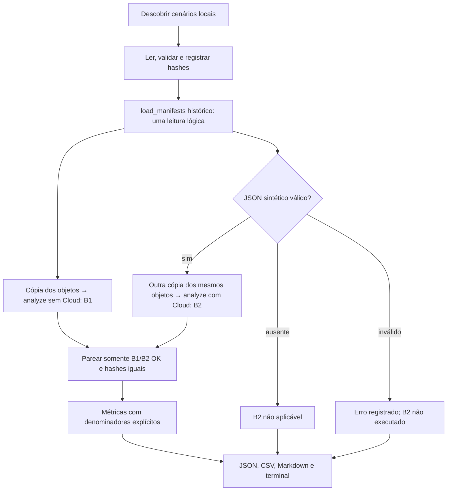

# CP01.2 — Executor experimental e comparação preliminar B1 × B2

Execução: 26/11/2026, America/Fortaleza. Classificador histórico em HEAD `b62d233e9a77a975d881b900c65212dea85bf7f9`. Nenhuma revisão das regras foi implementada. B0 permanece pendente de confirmação com Jan.

## A. Resumo da implementação

Implementado `run_experiments.py`, reutilizando `load_manifests`, `Cloud`, `analyze`, `LEVELS` e `RANK` do classificador existente. Descobre diretórios de cenários em ordem estável, executa B1 sem nuvem e B2 somente com snapshot JSON estruturalmente válido, registra falhas e exporta resultados completos. Ausência de snapshot é `not_applicable`, nunca classificação B2. Não implementa B0.

Resultado observado: 16 execuções B1, 10 B2, 10 pares, seis B2 não aplicáveis e nenhum erro na rodada oficial. Três pares mudaram de categoria. São resultados de **concordância com rótulos sintéticos históricos**, sem demonstração de superioridade científica.

## B. Arquivos criados e modificados

Novos neste checkpoint:

- [`run_experiments.py`](../run_experiments.py): executor, métricas, relatório e exportação.
- [`tools/offline_python.py`](../tools/offline_python.py): inicialização sem site/.pth e barreiras de auditoria Python.
- [`tests/test_run_experiments.py`](../tests/test_run_experiments.py): 21 testes locais.
- Este relatório de execução.
- [`results/cp01.2/raw_results.json`](../results/cp01.2/raw_results.json): 32 registros B1/B2, incluindo seis não aplicáveis, com 26 resultados de classificação completos.
- [`results/cp01.2/paired_comparison.csv`](../results/cp01.2/paired_comparison.csv): dez pares, confiança legada, mudanças e diferenças textuais de evidência.
- [`results/cp01.2/summary.json`](../results/cp01.2/summary.json): métricas, versões, hashes e tempos.
- [`results/cp01.2/report.md`](../results/cp01.2/report.md): relatório descritivo gerado pelo executor.
- [`results/cp01.2-validation/`](../results/cp01.2-validation/): logs históricos, testes, terminal e hashes de preservação antes/depois.

Nenhum arquivo preexistente modificado. Os cinco documentos CP01.1 e os dois PDFs já estavam não rastreados antes deste checkpoint. O classificador, os dois scripts históricos, todas as fixtures, rótulos e PDFs mantiveram os hashes; `requirements.txt` também foi preservado. Nenhuma dependência instalada.

## C. Arquitetura do executor



Referências de implementação: `run_experiments.py:28–57` limita caminhos/descobre diretórios; `60–94` valida o subconjunto estrutural JSON; `119–205` prepara e analisa sem duplicar regras; `216–246` pareia; `249–295` calcula métricas; `298–317` orquestra; `325–418` renderiza/exporta; `421–450` trata CLI e códigos de saída.

Manifesto é capturado e hashado, lido pelo parser histórico e conferido novamente contra os bytes capturados. B1/B2 recebem cópias independentes dos mesmos objetos. O snapshot é lido uma vez para bytes/JSON e fornecido somente a B2. Rótulo histórico nunca é passado ao classificador. Seu erro é registrado, preservando eventual output classificatório e excluindo o registro da comparação válida.

`legacy_confidence_by_workload` preserva a confiança por workload; não inventa confiança agregada do sistema. `result` mantém a saída integral com evidências e notas. Não foram adicionados campos classificatórios de suficiência ou fallback. O relatório inclui apenas metadados reais da execução.

## D. Comandos executados e reprodução

Antes de qualquer execução classificatória/teste, foram lidos o classificador e o executor histórico; revisados imports, operações de arquivo e carregamento seguro do PyYAML existente. Novos arquivos foram também inspecionados estaticamente antes de sua execução. Nenhum cliente cloud/Kubernetes ou rotina de credenciais foi encontrado nos caminhos executados. `yaml.safe_load_all` usa SafeLoader; os construtores inseguros disponíveis na biblioteca não são acionados pelo classificador.

Foi tentado `sandbox-exec` apenas com `python --version`, política sem rede e restrição de acesso ao diretório do usuário fora do projeto. O macOS retornou `sandbox_apply: Operation not permitted` (saída 71). Não foi solicitada elevação e nenhum teste foi executado por essa tentativa. Em seguida, a execução usou ambiente limpo e o launcher auditado.

Comandos de execução efetivamente utilizados, a partir da raiz:

```sh
env -i PATH=/usr/bin:/bin \
  HOME=/Users/andrezavilar/exposicao-sistema-ssvc \
  TMPDIR=/Users/andrezavilar/exposicao-sistema-ssvc \
  .venv/bin/python -I -S -B tools/offline_python.py run_scenarios.py

env -i PATH=/usr/bin:/bin \
  HOME=/Users/andrezavilar/exposicao-sistema-ssvc \
  TMPDIR=/Users/andrezavilar/exposicao-sistema-ssvc \
  .venv/bin/python -I -S -B tools/offline_python.py tests/test_run_experiments.py

env -i PATH=/usr/bin:/bin \
  HOME=/Users/andrezavilar/exposicao-sistema-ssvc \
  TMPDIR=/Users/andrezavilar/exposicao-sistema-ssvc \
  .venv/bin/python -I -S -B tools/offline_python.py run_experiments.py
```

A suíte histórica foi repetida após a rodada. Saídas foram arquivadas nos logs de validação. A primeira rodada de testes tinha 20 casos aprovados; após acrescentar verificação do SystemExit real da CLI e contagem de tentativas, a rodada final teve 21 aprovados.

O último comando **recusará repetir a gravação** porque `results/cp01.2/` já existe. Para reproduzir preservando a rodada anterior, acrescentar, por exemplo, `--output results/cp01.2-repeat-01`, escolhendo um diretório ainda inexistente. Não há opção de sobrescrita automática.

Verificações de integridade executadas: `git status --short --untracked-files=all`, `git diff --exit-code`, `git diff --cached --exit-code`, hashes SHA-256 locais e `diff -u` dos arquivos de hashes e dos logs históricos. Esses comandos não consultam remotos ou configurações de infraestrutura.

## E. Suíte histórica antes e depois

| Verificação | Resultado |
|---|---|
| Antes da rodada experimental | 16/16; distribuição 1 Small, 9 Controlled, 6 Open |
| Depois da rodada experimental | 16/16; mesma distribuição |
| Subestimativas/superestimativas históricas | 0/0 nas duas execuções |
| Comparação dos logs | Idênticos byte a byte |
| Comparação dos hashes protegidos | Idênticos |

Evidências: [`historical-before.txt`](../results/cp01.2-validation/historical-before.txt), [`historical-after.txt`](../results/cp01.2-validation/historical-after.txt), [`protected-before.sha256`](../results/cp01.2-validation/protected-before.sha256) e [`protected-after.sha256`](../results/cp01.2-validation/protected-after.sha256).

Precisão cronológica: o primeiro log histórico deste checkpoint foi registrado após a criação inicial dos arquivos novos do executor/launcher, mas antes da execução do executor experimental e dos testes. Os arquivos históricos permaneceram sem alterações desde o início, verificado também contra Git. Portanto, não se apresenta esse log como uma execução anterior à criação de qualquer arquivo novo.

## F. Resultados individuais B1 e B2

Todas as fixtures possuem um workload: `Deployment/demo/app`. A confiança abaixo é **heurística legada e não calibrada**. N/A significa ausência de snapshot, não uma categoria SSVC.

| Cenário | Rótulo histórico | B1 | Conf. B1 | B2 | Conf. B2 |
|---|---|---|---|---|---|
| 01 clusterip-netpol-restritiva | small | small | high | N/A | — |
| 02 clusterip-sem-netpol | controlled | controlled | medium | N/A | — |
| 03 clusterip-netpol-permissiva | controlled | controlled | high | N/A | — |
| 04 lb-aberto-confirmado-nuvem | open | open | medium | open | high |
| 05 lb-interno-confirmado-nuvem | controlled | controlled | medium | controlled | high |
| 06 lb-allowlist-confirmada | controlled | controlled | medium | controlled | high |
| 07 lb-allowlist-no-manifesto-mas-nuvem-aberta | open | controlled | medium | open | high |
| 08 lb-sem-fatos-de-nuvem | open | open | medium | N/A | — |
| 09 alb-internet-facing | open | open | medium | open | high |
| 10 alb-interno-padrao | controlled | controlled | medium | N/A | — |
| 11 nginx-lb-aberto | open | open | medium | open | high |
| 12 nginx-lb-aberto-com-allowlist | controlled | controlled | medium | controlled | high |
| 13 nodeport-nos-privados | controlled | open | low | controlled | high |
| 14 nodeport-nos-publicos-sg-aberto | open | open | low | open | high |
| 15 nodeport-nos-publicos-sg-restrito | controlled | open | low | controlled | high |
| 16 nlb-controlador-aws-padrao-interno | controlled | controlled | medium | N/A | — |

JSON bruto preserva nomes completos, resultados individuais, entradas, notas e evidências. Nenhuma classificação foi omitida por ser desfavorável.

## G. Comparação dos dez pares elegíveis

| Cenário | B1 → B2 | Confiança B1 → B2 | Direção | Concordância histórica |
|---|---|---|---|---|
| 04 | open → open | medium → high | Sem mudança | Mantida |
| 05 | controlled → controlled | medium → high | Sem mudança | Mantida |
| 06 | controlled → controlled | medium → high | Sem mudança | Mantida |
| 07 | controlled → open | medium → high | Aumento | Obtida em B2 |
| 09 | open → open | medium → high | Sem mudança | Mantida |
| 11 | open → open | medium → high | Sem mudança | Mantida |
| 12 | controlled → controlled | medium → high | Sem mudança | Mantida |
| 13 | open → controlled | low → high | Redução | Obtida em B2 |
| 14 | open → open | low → high | Sem mudança | Mantida |
| 15 | open → controlled | low → high | Redução | Obtida em B2 |

Os hashes de manifesto são iguais em cada par. Confiança muda em todos os dez pares: em sete, essa é a única mudança de categoria/confiança. As evidências textuais mudam também, registradas no CSV e no relatório gerado. “Apenas confiança” não significa output integral idêntico.

## H. Matriz de transição

Linhas = B1; colunas = B2; denominador = dez pares.

| B1 / B2 | Small | Controlled | Open |
|---|---:|---:|---:|
| Small | 0 | 0 | 0 |
| Controlled | 0 | 3 | 1 |
| Open | 0 | 2 | 4 |

Os zeros em Small não demonstram incapacidade geral: nenhum caso Small está no subconjunto com snapshot. A ordem é usada somente para direção ordinal, não como distância quantitativa de risco.

## I. Métricas e denominadores

| Conjunto/configuração | N executado | Small / Controlled / Open | Concordância histórica | Subestimativas | Superestimativas |
|---|---:|---|---|---|---|
| B1, todos | 16 | 1 / 8 / 7 | 13/16 = 81,25% | 1/16 = 6,25% | 2/16 = 12,5% |
| B1, pareado | 10 | 0 / 4 / 6 | 7/10 = 70% | 1/10 = 10% | 2/10 = 20% |
| B2, pareado e todos elegíveis | 10 | 0 / 5 / 5 | 10/10 = 100% | 0/10 | 0/10 |

Total de cenários: 16. Snapshots existentes/estruturalmente válidos: 10/10. Execuções tentadas/OK: B1=16/16; B2=10/10. Pares válidos: 10. Não aplicáveis: 6/16 registros B2. Erros na rodada: zero.

Mudanças de categoria: 3/10=30%; aumento 1/10=10%; redução 2/10=20%; permanência de categoria 7/10=70%. Grupos mutuamente exclusivos: aumento=1, redução=2, somente confiança=7, nenhuma mudança de categoria/confiança=0. Três ganhos e nenhuma perda de concordância histórica no pareamento.

A comparação justa é 7/10 versus 10/10. O valor 13/16 de B1 é separado e não deve ser contraposto diretamente ao 10/10 de B2 como se tivesse a mesma composição.

Tempo observado da rodada antes da exportação: **0,037604625 s**. Soma de análise+cópia: B1 todos=0,001024168 s; B1 pareado=0,000679666 s; B2=0,000578500 s. Parsing/preparação são compartilhados; esses valores não medem o custo de coleta AWS, que não ocorreu. Tempos e timestamps não são determinísticos e não sustentam comparação de desempenho com uma única medição.

## J. Análise das diferenças

**Cenário 07:** B1 usa source ranges restritos do manifesto e retorna Controlled. B2 encontra o LB sintético correlacionado com SG universal e retorna Open, registrando divergência. A mudança segue `service_entry:126–142` e `eval_lb:96–100` do classificador preservado. O snapshot é evidência sintética do experimento, não observação real.

**Cenário 13:** sem dados dos nós, B1 usa Open/low por pior caso; B2 recebe nós sem IP público e retorna Controlled/high (`exposure_analyzer.py:143–152`). O executor não altera nem valida cientificamente a premissa de ausência de IP público.

**Cenário 15:** B1 novamente assume Open/low sem nós. B2 encontra nó público com SG restrito na faixa NodePort e retorna Controlled/high (`153–156`). Não foi testada conectividade real.

**Casos sem mudança:** 04, 05, 06, 09, 11, 12 e 14 mantêm a categoria, mas o legado eleva confiança. O cenário 12 continua Controlled apesar do LB aberto porque o ramo nginx aplica allowlist; isso preserva a limitação já descrita no CP01.1, sem correção neste checkpoint (`188–196`).

**Interpretação limitada:** neste corpus, snapshots alteram decisões nos três casos destacados e tornam B2 concordante com os rótulos construídos para esses cenários. O desenho dos rótulos e snapshots não é independente do desenvolvimento das regras. Não se conclui superioridade científica, exposição operacional real nem validade de high.

## K. Testes automatizados

**21 testes aprovados em 0,128 s**, saída final `OK`; [log integral](../results/cp01.2-validation/unittest-final.txt). Cobrem:

- Descoberta ordenada, inventário real de 16 cenários/10 snapshots e exclusão dos seis sem snapshot.
- Mesmos objetos/hashes por par, separação de Cloud e isolamento contra mutação entre modos.
- Transições de aumento/redução, permanência e mudança somente de confiança; ganho/perda de concordância.
- Denominadores totais e pareados, inclusive zero pares.
- Exportação JSON/CSV/Markdown, outputs completos e recusa de sobrescrita.
- YAML/JSON/formato inválidos, manifesto/rótulo ausentes, ausência de workload e exceção de classificação.
- Código não zero por `main` e `SystemExit` do módulo CLI.
- Rejeição de caminhos externos/links simbólicos e mudança do manifesto durante a leitura.
- Reprodutibilidade categórica e eventos sintéticos de auditoria de rede/subprocesso, sem abrir socket nem iniciar processo.

Os testes com falhas usam fixtures novas e temporárias exclusivamente sob `tests/`, removidas ao final. Não modificam `scenarios/` e não executam gerador.

## L. Limitações científicas e técnicas

Corpus pequeno e sintético, com rótulos de mesma autoria do protótipo; nenhum oráculo independente, observação de rede ou avaliação B0. B1 mantém annotations AWS, conforme autorizado. As categorias e confiança são integralmente legadas; este checkpoint não implementa o modelo revisado do CP01.1.

Validação de snapshot é do subconjunto estrutural necessário ao executor, não validação abrangente de schemas AWS nem prova de completude. Dados semanticamente incompletos podem conservar os problemas do classificador. Erros por cenário são exportados; erros globais como raiz inexistente ou destino já existente geram mensagem no stderr e saída não zero, sem regravar uma rodada anterior.

Não há sandbox adicional de SO ativa: a tentativa foi recusada. Audit hooks Python não são uma barreira contra código nativo malicioso e não substituem isolamento de máquina. O código executado foi revisado, sem dependência externa, e as operações observadas permaneceram locais. Não se afirma bloqueio de rede imposto pelo kernel.

## M. Estado final do Git

Branch `main`, sem alterações rastreadas ou staged (`git diff` e `git diff --cached` vazios). Novos arquivos do checkpoint estão não rastreados. Documentos CP01.1 e PDFs já estavam não rastreados no início; PDFs permanecem fora do índice. Nenhum commit, push, fetch ou mudança de configuração Git.

Classificador SHA-256: `923c98497639bd9a7a05c79f98a9a252c1b0ef840af985750c6eeb7c1eabec7b`.

Executor SHA-256 da rodada: `75392fd963847c6c91b3c866440ab6d49951b04da9b2e2289670e847a00dd751`.

## N. Conformidade e isolamento

- Ambiente iniciado com `env -i`; não houve leitura ou enumeração de variáveis sensíveis.
- Interpretador exclusivo `.venv/bin/python`; `-I -S -B` ignora ambiente Python, site/.pth e gravação de bytecode. Apenas o PyYAML já instalado no venv é adicionado explicitamente ao caminho de importação.
- Launcher bloqueia eventos Python de socket, subprocessos e ctypes; limita abertura/listagem de arquivos ao projeto e runtime Python, com escrita apenas no projeto.
- Nenhuma AWS CLI, SDK cloud, API AWS/Kubernetes, kubectl, Helm ou Terraform foi utilizada. Nenhuma conta, cluster, contexto, profile, credencial ou configuração profissional foi consultada.
- Nenhuma conexão de rede foi realizada pelos testes/experimentos. Dados AWS permaneceram JSONs locais; manifestos permaneceram YAMLs locais.
- Nenhum recurso externo criado, modificado ou removido. Conta AWS pessoal futura permanece não autorizada; proteção do ambiente profissional é permanente.
- Nenhuma regra científica foi alterada e nenhum novo indicador classificatório foi inventado.

**CP01.2 tecnicamente concluído. CP02 não iniciado; aguardar autorização explícita.**
