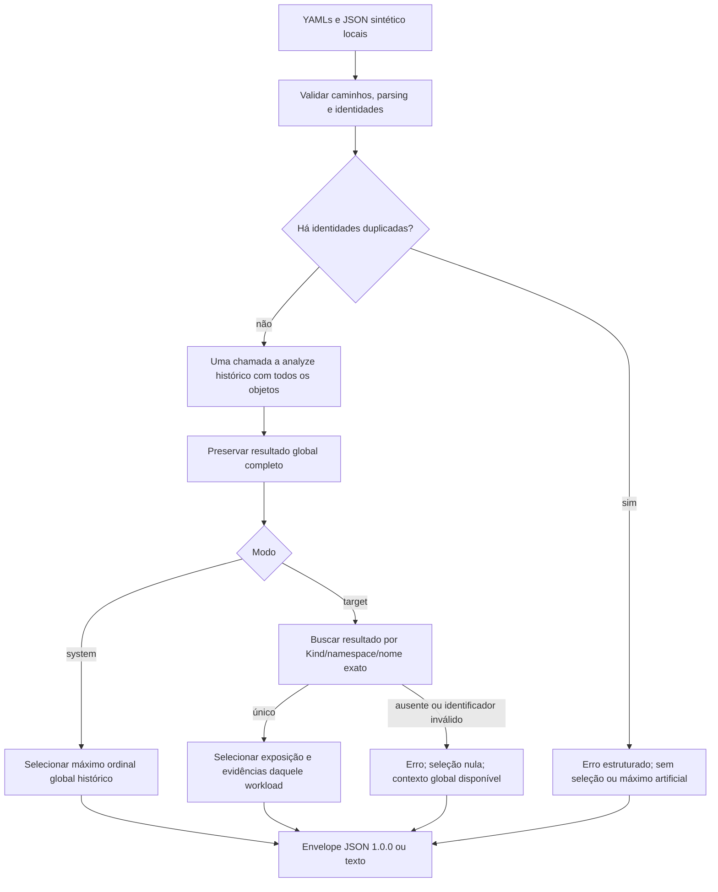

# CP02.1 — Unidade de análise e seleção explícita

Data: 26/11/2026 (America/Fortaleza). Estado: implementação e verificações locais concluídas. Somente CP02.1 executado; CP02.2 não iniciado. Resultados referem-se ao classificador histórico, não à validade científica de suas regras.

## A. Resumo executivo e problema identificado

O classificador existente retorna exposição por workload e usa o máximo ordinal como `system_exposure` (`exposure_analyzer.py:223–275`). Em um conjunto com frontend aberto e backend restrito, atribuir o máximo global ao backend ocultaria essa diferença. A nova camada permite escolher explicitamente qual resultado histórico deve ser apresentado como unidade avaliada, conservando todo o conjunto como contexto.

**Implementado:** `system` para visão do conjunto de manifestos e `target` para um workload exato. Não houve alteração de regras, nem descoberta de componentes vulneráveis, associação de CVEs ou coleta de infraestrutura.

Na fixture nova, o contexto global é Open; selecionar `Deployment/demo/backend` retorna Controlled, e selecionar `Deployment/demo/worker` retorna Small pelas regras legadas. Alvo inexistente não recebe Open como substituto: retorna erro, classificação selecionada nula e mantém o contexto global separado.

**Delimitação científica:** a seleção de workload é uma decisão operacional provisória do protótipo, não uma definição normativa estabelecida pelo SSVC. Workload não equivale automaticamente a biblioteca, processo ou funcionalidade afetada. A fundamentação permanece em [CP01.1](cp01-ssvc-foundation.md), especialmente seções 3–5, e as decisões propostas em [cp01-design-decisions.md](cp01-design-decisions.md#2-unidade-de-análise).

Foi revisitada a seção 5.2 do [artigo local](../SSVC_Copilot.pdf), p. 8: o trabalho original relaciona exposição ao serviço e ao contexto de implantação, usando CVSS como evidência auxiliar e permitindo revisão/reuso pelo operador. A revisão atual leu os streams textuais locais com `zlib` da biblioteca padrão, sem modificar o PDF ou instalar leitor; complementa a leitura integral e inspeção visual já realizadas no CP01.1. Essa seção não determina que um recurso Kubernetes seja a unidade normativa correta. A equivalência não é reivindicada aqui.

## B. Arquitetura escolhida e justificativa

Foi adotado [`exposure_analyzer_v2.py`](../exposure_analyzer_v2.py) como camada fina. “v2” identifica a interface de seleção deste checkpoint, não um novo conjunto de regras SSVC ou nova versão oficial do SSVC.



Referências da implementação:

- `workload_ids`, linhas 78–96: identificação explícita sem implementar regras de exposição.
- `analyze_units`, linhas 99–149: validação, única chamada ao legado, seleção e envelope de erro.
- `manifest_files` e `analyze_files`, linhas 152–198: leitura local, recusa de symlinks, parsing histórico, hash e snapshot opcional.
- `render_text` e `main`, linhas 201–232: CLI e renderização.

`analyze_units()` chama `legacy.analyze()` com cópias dos objetos completos e do Cloud local. Não filtra os manifestos para o alvo: isso preserva Services, Ingresses e controladores necessários à correlação histórica. Após obter o resultado completo, seleciona uma entrada por identidade exata. Evidências, notas e confiança são copiadas sem reinterpretá-las.

Foram reutilizadas de `run_experiments.py` apenas as funções puras `local_path` e `validate_cloud` para evitar duplicar os controles locais já existentes. Importar esse módulo não inicia experimentos: a CLI histórica está protegida por `if __name__ == '__main__'`. Esse acoplamento pequeno é explícito e pode ser reavaliado posteriormente, sem refatorar os arquivos preservados agora.

### Unidade operacional e modos

Identidade: `Kind/namespace/nome`, sensível a maiúsculas/minúsculas, sem abreviação ou seleção por nome parcial. Kinds suportados correspondem aos do legado: Deployment, StatefulSet, DaemonSet, ReplicaSet e Pod. Namespace omitido usa `default`, como o legado. Nome ausente, campos vazios, espaços nas bordas ou `/` dentro dos componentes são recusados. Não se pretende validar o schema Kubernetes completo.

Em **system**, a unidade selecionada é `manifest_set`, sem inventar nome de sistema; `selected_exposure` corresponde a `global_exposure`. A fronteira normativa de sistema não é presumida.

Em **target**, a unidade é `workload`, com o identificador solicitado. `selected_exposure` vem exclusivamente daquele resultado; `global_exposure` continua disponível como contexto. Mesmo quando são iguais, são campos semanticamente distintos.

**Duplicatas:** duas declarações com a mesma identidade canônica não são silenciosamente mescladas, mesmo se tiverem conteúdo idêntico. Rejeita-se o conjunto em ambos os modos, pois um contexto global com identidades duplicadas poderia ser enganoso. Se o alvo for a identidade repetida, o código é `ambiguous_target`; nos demais casos, `duplicate_workload_identities`. Nesse erro de entrada, o legado não executa e o contexto global permanece nulo. Duplicatas em uma parte do conjunto também invalidam a análise de outro alvo: é uma política operacional conservadora de validação, documentada e testada.

## C. Arquivos criados e preservados

Criados:

- [`exposure_analyzer_v2.py`](../exposure_analyzer_v2.py).
- [`tests/test_exposure_analyzer_v2.py`](../tests/test_exposure_analyzer_v2.py), separado dos testes históricos.
- [`tests/fixtures/cp02.1/multi-workload.yaml`](../tests/fixtures/cp02.1/multi-workload.yaml).
- [`tests/fixtures/cp02.1/cloud.json`](../tests/fixtures/cp02.1/cloud.json), snapshot sintético.
- Este documento.
- [`results/cp02.1-validation/`](../results/cp02.1-validation/), logs, hashes e exemplos efetivamente executados.

Nenhum arquivo preexistente foi alterado. `exposure_analyzer.py`, `run_experiments.py`, `run_scenarios.py`, `build_scenarios.py`, testes históricos, cenários, rótulos, resultados CP01.2, documentos anteriores e PDFs foram preservados. Não foi executado `build_scenarios.py`.

## D. Contrato de entrada e JSON

### Entrada Python

```python
analyze_units(objects, cloud=None, mode='system', target=None)
analyze_files(manifests, cloud_path=None, mode='system', target=None)
```

`objects` é uma lista de objetos já carregados; `cloud` é o objeto offline `Cloud` histórico. A API não obtém dados de serviços. `analyze_files` aceita arquivo individual ou diretório recursivo de `.yaml`/`.yml`, com expansão histórica de `kind: List`; arquivo individual segue o parser histórico independentemente da extensão. O JSON opcional usa o subconjunto estrutural já aceito pelo executor. Caminhos devem estar no repositório; symlinks e componentes `..` são recusados antes de abrir os arquivos correspondentes.

### Envelope `schema_version: 1.0.0`

| Campo | Semântica |
|---|---|
| `schema_version` | Versão deste contrato, independente da versão oficial do SSVC |
| `classifier` | ID e SHA-256 do legado; ID e SHA-256 da camada de seleção |
| `mode` | system ou target |
| `selected_unit` | Tipo da unidade; identificador solicitado em target, nulo em system |
| `selected_exposure` | Categoria histórica selecionada ou nulo em erro |
| `selected_result` | Resultado integral do workload selecionado; nulo em system ou erro |
| `selected_legacy_confidence` | Confiança heurística original do workload; nula em system ou erro |
| `global_exposure` | Máximo global do legado quando a análise completa foi possível |
| `aggregation` | Estratégia global, ordem ordinal, escopo, estratégia de seleção e flag de fronteira normativa não presumida |
| `workloads_found` | Identidades explícitas encontradas, na ordem da entrada |
| `global_result` | Saída integral do legado, incluindo todos os workloads, evidências, notas e confiança |
| `inputs` | Na API de arquivos: caminhos relativos, hashes e origem sintética do snapshot; nulo na API de objetos |
| `status` | ok ou error; são estados da operação, não categorias SSVC |
| `errors` | Lista de objetos com code, message e details |
| `limitations` | Limites científicos e operacionais explícitos |

Não se produz uma confiança agregada artificial: o legado não define confiança global. Em system, as confianças continuam nos resultados individuais de `global_result.workloads`.

As evidências continuam sendo as strings legadas em `entrypoints[].evidence`, com notas em `notes`. O envelope não implementa o modelo estruturado de evidências do CP02.2 nem acrescenta uma nova categoria de exposição, probabilidade ou indicador de suficiência.

Exemplo abreviado, derivado da execução real do backend (os campos omitidos permanecem no JSON completo):

```json
{
  "schema_version": "1.0.0",
  "mode": "target",
  "selected_unit": {"type": "workload", "identifier": "Deployment/demo/backend"},
  "selected_exposure": "controlled",
  "selected_legacy_confidence": "medium",
  "global_exposure": "open",
  "status": "ok",
  "errors": []
}
```

### Erros e códigos de saída

Erros de domínio/entrada geram o mesmo envelope, com `status=error`, `selected_exposure=null`, `selected_result=null` e `selected_legacy_confidence=null`. A CLI retorna **1**. Se o legado pôde executar, alvo inexistente ou identificador inválido conserva o contexto global; erros de parsing, duplicatas ou ausência de workloads impedem esse contexto.

Códigos: `invalid_mode`, `unexpected_target`, `invalid_objects`, `invalid_workload_identity`, `duplicate_workload_identities`, `ambiguous_target`, `no_supported_workloads`, `invalid_target_identifier`, `target_not_found`, `legacy_analysis_error`, `manifest_path_not_found`, `no_manifest_files`, `input_changed` e `input_error`.

`--target` em system é recusado para evitar ignorar intenção do usuário. Target mode sem alvo é erro estruturado. Argumentos CLI sintaticamente inválidos, como ausência de `--manifests` ou `--format` desconhecido, seguem o argparse: mensagem em stderr e saída 2, fora do envelope de domínio. Nenhum erro faz seleção automática de outro workload.

## E. Exemplos reproduzíveis

Na raiz do projeto, definir apenas nesta sessão de shell a função auxiliar (não modifica arquivos de configuração):

```sh
offline_python() {
  env -i PATH=/usr/bin:/bin \
    HOME=/Users/andrezavilar/exposicao-sistema-ssvc \
    TMPDIR=/Users/andrezavilar/exposicao-sistema-ssvc \
    .venv/bin/python -I -S -B tools/offline_python.py "$@"
}
```

Análise global e direcionada:

```sh
offline_python exposure_analyzer_v2.py \
  --manifests tests/fixtures/cp02.1/multi-workload.yaml \
  --mode system --format json

offline_python exposure_analyzer_v2.py \
  --manifests tests/fixtures/cp02.1/multi-workload.yaml \
  --mode target --target Deployment/demo/backend --format json

offline_python exposure_analyzer_v2.py \
  --manifests tests/fixtures/cp02.1/multi-workload.yaml \
  --cloud tests/fixtures/cp02.1/cloud.json \
  --mode target --target Deployment/demo/frontend --format json

offline_python exposure_analyzer_v2.py \
  --manifests tests/fixtures/cp02.1/multi-workload.yaml \
  --mode target --target Deployment/demo/missing --format json
```

| Execução real | Selecionada | Global | Confiança selecionada | Status / saída |
|---|---|---|---|---|
| system | open | open | nula, sem agregação inventada | ok / 0 |
| target backend | controlled | open | medium | ok / 0 |
| target frontend + snapshot | open | open | high | ok / 0 |
| target missing | nula | open | nula | error / 1 |

Saídas completas arquivadas em [`system.json`](../results/cp02.1-validation/system.json), [`target-backend.json`](../results/cp02.1-validation/target-backend.json), [`target-frontend-cloud.json`](../results/cp02.1-validation/target-frontend-cloud.json) e [`target-missing.json`](../results/cp02.1-validation/target-missing.json). O alvo inválido foi executado e retornou efetivamente 1; não é resultado simulado. Seleções Open/Controlled/Small sem snapshot também foram verificadas nos testes.

## F. Novos testes

**26 testes aprovados, 0,150 s**, usando unittest, biblioteca padrão e fixtures sintéticas locais. [Log integral](../results/cp02.1-validation/new-tests.txt).

Cobertura dos requisitos:

| Requisito | Testes principais |
|---|---|
| Workload único | `test_single_workload` |
| Múltiplos níveis / system | `test_multiple_workloads_and_explicit_system_strategy` |
| Seleção Open/Controlled/Small | `test_select_open`, `test_select_controlled_does_not_inherit_open_global`, `test_select_small_keeps_evidence_and_notes` |
| Alvo ausente/formato parcial | `test_unknown_target_is_error_with_global_context_not_substitution`, `test_full_identifier_required` |
| Nome igual, namespaces/kinds diferentes | `test_same_name_different_namespaces`, `test_same_name_different_kinds` |
| Nenhum workload suportado | `test_no_supported_workloads` |
| Duplicatas e alvo ambíguo | `test_duplicate_target_is_ambiguous_before_legacy_analysis`, `test_duplicates_in_system_or_other_target_reject_whole_input` |
| Com/sem snapshot | `test_snapshot_changes_only_legacy_inputs_and_confidence` |
| Preservação do legado | `test_all_historical_results_equal_in_b1_and_b2` |
| Determinismo | `test_determinism_and_json_versioned_contract` |
| Não filtrar recursos / não mutar entrada | `test_analyze_called_once_with_all_resources_and_no_mutation` |
| CLI e código não zero | `test_cli_json_and_text`, `test_cli_main_module_nonzero_json_error` |
| Diretórios, List e entradas inválidas | testes específicos de parsing, identidade e erros |
| Caminhos externos / symlinks | `test_rejects_external_and_symlink_paths_before_loading` |

A regressão contra o legado cobre os 16 cenários sem snapshot e os dez com snapshot: **26 combinações de entradas**, comparando saída global integral e resultado target ao workload original. Isso não são 26 cenários independentes nem validação das categorias.

Temporários são criados sob `tests/` e removidos ao final. Nenhum teste altera fixtures históricas. A fixture nova não tem rótulo científico esperado; seus níveis são usados para verificar lookup e agregação do legado.

## G. Testes históricos

| Verificação | Antes da implementação | Depois |
|---|---|---|
| Testes CP01.2 | 21 aprovados; 0,133 s | 21 aprovados; 0,127 s |
| Suíte sintética original | 16/16 | 16/16 |
| Small / Controlled / Open históricos | 1 / 9 / 6 | 1 / 9 / 6 |
| Subestimativas / superestimativas históricas | 0 / 0 | 0 / 0 |

Logs: [`existing-tests-before.txt`](../results/cp02.1-validation/existing-tests-before.txt), [`existing-tests-after.txt`](../results/cp02.1-validation/existing-tests-after.txt), [`historical-before.txt`](../results/cp02.1-validation/historical-before.txt) e [`historical-after.txt`](../results/cp02.1-validation/historical-after.txt). As duas saídas da suíte original são idênticas byte a byte.

No total, **47 testes distintos** passaram na verificação final: 26 novos + 21 existentes. A suíte de 16 cenários é contabilizada separadamente. Os resultados exportados do CP01.2 continuam preservados: B1 completo 13/16, B1 pareado 7/10, B2 pareado 10/10. Não foi gravada outra rodada sobre os resultados anteriores.

## H. Hashes e preservação

Foram registrados SHA-256 de **68 arquivos preexistentes** antes e depois: código legado, executor, scripts, teste histórico, launcher, dependência declarada, 16 cenários e seus rótulos/snapshots, resultados/logs CP01.2, documentos CP01 e PDFs.

[`protected-before.sha256`](../results/cp02.1-validation/protected-before.sha256) e [`protected-after.sha256`](../results/cp02.1-validation/protected-after.sha256) são idênticos. O hash do classificador permanece `923c98497639bd9a7a05c79f98a9a252c1b0ef840af985750c6eeb7c1eabec7b`; o executor CP01.2 permanece `75392fd963847c6c91b3c866440ab6d49951b04da9b2e2289670e847a00dd751`.

O adaptador identifica seu próprio hash nas saídas: `e3ce2654eab02c4ca4404a54f921afa0f16497036852146efc4f2dbb3eea901a`. Não foram criadas cópias integrais do classificador nem alterados artefatos históricos para acomodar a nova interface.

## I. Limitações e decisões pendentes

- Workload é aproximação operacional; Andrey ainda deve validar a unidade científica componente/implantação e o relacionamento com vulnerabilidades.
- O máximo é mantido por compatibilidade, com fronteira limitada ao conjunto carregado. Não representa automaticamente toda a aplicação ou organização.
- Small/Controlled/Open e confiança são legados, inclusive suas limitações de NetworkPolicy, SGs, CNI e caminhos incompletos. Seleção correta não valida a categoria selecionada.
- Não há SBOM, CVE→workload, identificação de funções vulneráveis ou prova de alcançabilidade do código.
- Objetos Pod e controladores presentes juntos podem representar instâncias relacionadas; não há deduplicação por ownerReferences. Identidades exatas continuam distintas.
- Duplicatas causam erro do conjunto completo; essa política e eventual normalização posterior precisam de decisão explícita.
- Erros no parsing ou na análise global podem impedir seleção de um alvo válido; a camada não oculta erros de outros recursos filtrando a entrada.
- A validação de arquivos e do snapshot é parcial, sem substituição dos schemas oficiais. Suporte científico a confiança/suficiência e evidências estruturadas fica fora deste checkpoint.
- B0 continua dependente de confirmação com Jan; este checkpoint não altera essa dependência.
- Não há prova de isolamento por kernel. Foi reutilizado o launcher auditado já disponível, sem nova tentativa de sandbox adicional e sem elevação.

Decisões com orientador: granularidade abaixo do workload, significado do máximo no relato científico, política de duplicatas e forma de fornecer vínculo explícito de vulnerabilidade. Não é necessária participação contínua para executar os testes locais.

## J. Comandos executados

As execuções Python usaram exclusivamente `.venv/bin/python -I -S -B tools/offline_python.py`, com `env -i` e PATH/HOME/TMPDIR explícitos do exemplo. Scripts executados: `run_scenarios.py` antes/depois; `tests/test_run_experiments.py` antes/depois; `tests/test_exposure_analyzer_v2.py`; quatro exemplos CLI da seção E. Nenhuma dependência foi instalada.

Inspeção local: leitura dos fontes e documentos exigidos; `rg` de imports e operações potencialmente externas; releitura textual do PDF com biblioteca padrão; `git status`, `git log -5 --oneline`, `git diff`; hashes `shasum -a 256` e comparação `diff -u` dos dois manifestos de hashes e logs históricos. Nenhum comando consulta remotos, conta, credencial ou contexto.

Para repetir os testes, após definir a função `offline_python` acima:

```sh
offline_python tests/test_exposure_analyzer_v2.py
offline_python tests/test_run_experiments.py
offline_python run_scenarios.py
```

## K. Conformidade com as restrições

Toda entrada experimental, fixture, temporário e saída está dentro do repositório acadêmico. O runtime Python e suas bibliotecas existentes são usados apenas para executar o código local autorizado.

Não foram consultados, listados ou modificados `~/.aws`, `~/.kube`, profiles, tokens, contextos ou variáveis sensíveis. Nenhuma AWS CLI, boto3, SDK cloud, API Kubernetes, kubectl, Helm, Terraform, sudo, scanner ou exploração foi utilizada. Não houve instalação, conexão de rede, provisionamento ou interação com conta pessoal/corporativa.

Antes das execuções, foram revisados os caminhos de código; a camada nova contém somente imports locais e biblioteca padrão. O launcher CP01.2 foi reutilizado sem alterações, com ambiente limpo, inicialização sem site/.pth, bloqueios de eventos de rede/subprocesso/ctypes e restrição de arquivos ao projeto/runtime. Essa proteção não é apresentada como sandbox de SO nem como barreira contra código nativo malicioso.

Não se seguiu symlink para fora do projeto. O teste de symlink usa alvo fictício local e verifica recusa antes de chamar o parser. Arquivos protegidos não foram abertos para testar proteção. Os PDFs permaneceram não rastreados, sem modificações. Não houve envio de dados para serviços externos.

## L. Estado final do Git e encerramento

Branch `main`, HEAD inicial `ed6cc62` (commit realizado pelo usuário antes deste checkpoint). Nenhuma alteração rastreada/staged; apenas os novos arquivos listados na seção C e os dois PDFs já não rastreados no início. Nenhum commit, push ou mudança de configuração Git foi realizado pelo agente.

**CP02.1 concluído. Trabalho interrompido ao final. CP02.2 e qualquer coleta real permanecem não autorizados; aguardar autorização explícita.**
