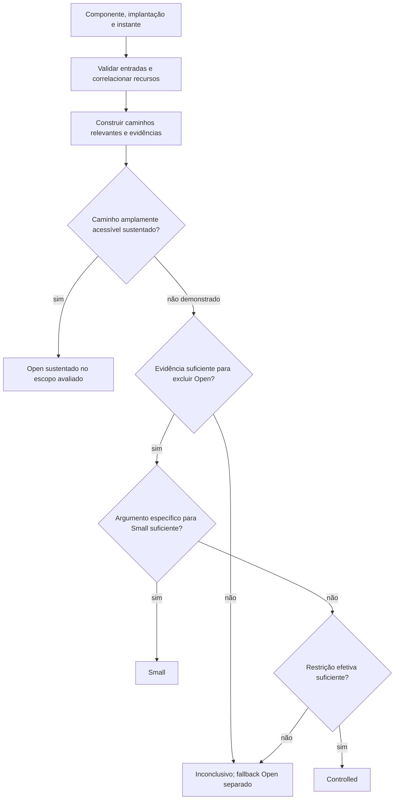

# CP01.1 — Propostas de decisões científicas e arquiteturais

> Nota de organização: caminhos e links foram atualizados após o checkpoint. Resultados, hashes e estados de Git descritos abaixo são registros históricos da execução original. Veja o README para a estrutura atual.

Data: 26/11/2026. **Todas as decisões abaixo são propostas para discussão com Andrey, não aprovações nem funcionalidades implementadas.** Base científica: [fundamentação](cp01-ssvc-foundation.md); revisão detalhada: [20 regras](cp01-rule-traceability.md).

## 1. Estado atual e objetivo da revisão

**Fato:** a análise é por Deployment/StatefulSet/DaemonSet/ReplicaSet/Pod (`src/exposure_analyzer.py:223–241`). Saída por workload contém exposição, confiança, entradas e notas (`272–275`). O máximo global é usado como exposição do sistema (`274`). Não existe associação explícita CVE→componente nessa interface.

**Proposta D01:** preservar parser, avaliadores de entradas, CLI offline e funções Python; evoluir evidências e regras incrementalmente. Não adotar agentes LLM, motor genérico de políticas, serviços web ou refatoração ampla para resolver as lacunas deste checkpoint.

## 2. Unidade de análise

| Conceito | Definição de trabalho proposta | Consequência |
|---|---|---|
| Workload | Recurso que executa ou gerencia Pods; uma implantação técnica | Não equivale necessariamente a uma aplicação ou componente de software |
| Serviço Kubernetes | Abstração de acesso que seleciona endpoints; mecanismo de rede [S10 da fundamentação] | Pode atender vários Pods e não contém toda a semântica da aplicação |
| Serviço funcional | Capacidade oferecida a usuários ou outros componentes | Não confundir com kind Service |
| Aplicação | Conjunto explicitamente delimitado de componentes que entrega uma função | Precisa de fronteira declarada |
| Sistema | Fronteira de análise escolhida, com ativos e relações | Não deve ser inferido apenas do diretório de YAMLs |
| Componente afetado | Produto/biblioteca/processo e versão afetados por uma vulnerabilidade | Precisa ser associado às instâncias e interfaces pertinentes |

**Proposta D02:** unidade primária = **componente afetado em uma implantação identificada, no instante de referência**. Identificação mínima proposta: `assessment_id`, `component_id`, `deployment_scope`, `workload_refs`, interfaces relevantes e instante; `vulnerability_id` pode ser ausente para inventário genérico de exposição, mas a classificação deve dizer que não é uma avaliação específica de CVE.

Essa unidade serve à integração com o Copilot sem implementar descoberta automática de SBOM ou aplicabilidade. O vínculo componente↔workload pode ser fornecido explicitamente pelo experimento. Não inferir que toda vulnerabilidade da imagem é alcançável por toda porta publicada. Quando o componente específico não puder ser associado, registrar essa falta e a escala mais ampla efetivamente avaliada.

O modelo deployer trata de ação sobre instâncias e remediações [S3, Units of Work]; a unidade proposta é a unidade de **medição de exposição**, não uma redefinição da unidade oficial de trabalho de priorização.

### 2.1. Múltiplos componentes e agregação

Exemplo **conceitual**, não nova fixture nem resultado: frontend com caminho público e banco restrito. O máximo da aplicação pode ser Open, mas uma vulnerabilidade exclusiva do banco deve usar a avaliação do banco e suas interfaces. O frontend público é um contexto de possível caminho indireto, não prova automática de acesso ao banco nem autorização para simular exploração.

**Proposta D03:** máximo entre caminhos pertinentes do mesmo componente; máximo entre componentes apenas como resumo opcional da fronteira. Preservar resultados individuais e participantes da agregação. Não propagar automaticamente esse resumo a todos os CVEs.

Se existir caminho aberto suficientemente sustentado, o componente pode ser Open mesmo que outros caminhos sejam desconhecidos: o caminho aberto já determina o máximo. Se os caminhos conhecidos são Controlled/Small e há caminho relevante desconhecido, o máximo conhecido é apenas um limite inferior. Não devolver resumo reduzido definitivo. Inventário vazio deve ser “sem alvo avaliado”, não Small.

## 3. Evidências e incerteza

**Fato atual:** `Entry` armazena strings de evidência e uma confiança (`104–110`). LB com snapshot correlacionado recebe high (`136–140,175–177`); inferência de manifesto recebe medium (`141–142,178–180`); nós/controlador desconhecidos recebem low (`146–148,185–187`). Sem entradas externas, confiança depende da presença de política (`267–268`). Não há calibração estatística.

**Proposta D04:** substituir a confiança como principal indicador por dimensões auditáveis de suficiência. Se low/medium/high forem mantidos temporariamente por compatibilidade, marcá-los como legados e não probabilísticos.

| Dimensão proposta | Valores exemplificativos | Significado |
|---|---|---|
| Origem do fato | `declared`, `observed` | Manifesto/intenção versus observação de recurso ou comportamento |
| Derivação | `direct`, `inferred` | Leitura de campo versus conclusão obtida por regra |
| Proveniência | arquivo, objeto, campo, instante, hash, produtor | Permite reconstruir a justificativa |
| Suficiência | `sufficient`, `insufficient`, `not_assessed` | Relativa ao critério, escopo e modo declarado/operacional |
| Consistência | `consistent`, `conflicting`, `not_checked` | Contradições não desaparecem ao escolher uma fonte |
| Cobertura | caminhos/campos avaliados e faltantes | Não confundir “não observado” com “ausente” |
| Estado do resultado | `determined`, `inconclusive`, `no_target` | Metadado da avaliação, não novo valor SSVC |
| Decisão operacional | valor oficial e flag de fallback | Se necessário, Open conservador separado da conclusão sustentada |

Um snapshot sintético tem origem “synthetic”, mesmo quando imita um dado observado. Observação de configuração AWS prova o campo observado naquele instante, não automaticamente alcance fim a fim nem exploração. “Declarado” e “inferido” são dimensões diferentes: pode haver inferência a partir de declaração.

### 3.1. Contrato conceitual de saída

Exemplo **de schema proposto**, sem implementação e sem cenário experimental criado:

```json
{
  "assessment_status": "inconclusive",
  "exposure": null,
  "candidate_exposure": "controlled",
  "evidence_basis": "declared_configuration",
  "sufficiency": "insufficient",
  "missing_evidence": ["enforcement", "complete_entrypoint_inventory"],
  "contradictions": [],
  "operational_exposure": "open",
  "fallback_applied": true,
  "fallback_reason": "unknown_operational_exposure",
  "ssvc_decision_point": "ssvc:EXP:1.0.1"
}
```

`null`, `inconclusive` e demais metadados não são novas categorias SSVC. `operational_exposure` usa um valor oficial; um consumidor que exige uma categoria pode receber Open com fallback explícito. Não contar esse fallback como Open empiricamente confirmado. Congelar nomes e compatibilidade somente após revisão no CP01.2.

### 3.2. Política de conflitos proposta D05

1. Comparar escopo, instante e origem antes de tratar dois fatos como contraditórios.
2. Registrar ambos e seus ponteiros, sem apagar a configuração declarada.
3. Preferir evidência pertinente e atual para o fato que ela realmente observa; não usar precedência universal AWS>Kubernetes.
4. Uma observação atual de alcance amplo ao componente pode sustentar Open apesar de intenção restritiva.
5. SG aberto e allowlist de rota podem coexistir em camadas diferentes. Avaliar restrição e bypass da rota antes de concluir contradição ou redução.
6. Se o conflito impedir conclusão, preservar candidato e retornar inconclusivo; se exigida decisão operacional, fallback Open.

## 4. Modelo de decisão revisado proposto D06

O fluxo seguinte é uma especificação conceitual futura, não arquitetura já implementada:



Critérios operacionais propostos:

- **Open sustentado:** caminho ao componente pertinente, origem amplamente acessível e ausência de restrição efetiva nesse caminho, conforme as capacidades avaliadas. Permissão de SG sozinha é evidência parcial.
- **Controlled sustentado:** fronteira/caminhos suficientemente conhecidos; Open afastado no escopo; restrição pertinente demonstrada. Não presumir que toda rede privada é altamente controlada.
- **Small sustentado:** argumento contextual adicional compatível com a referência oficial, sem depender apenas de ClusterIP/NetworkPolicy. Se dados disponíveis não permitirem isso, manter inconclusivo.
- **Configuração declarada:** B1 pode produzir uma conclusão condicionada sobre o modelo declarado, identificada como tal. Isso não se torna afirmação operacional por omissão de flag.
- **Escopo não suportado:** hostNetwork/hostPort, caminhos sem correlação ou semântica de política não interpretada geram lacunas explícitas; não tornam o componente artificialmente menos exposto.

As heurísticas oficiais Small/Controlled mencionam Automatable e funcionalidade vulnerável não utilizada [S2]. **Proposta D07:** não inventar esses dados a partir de manifestos. Na avaliação primária B1/B2, ausência dessas informações permanece lacuna. Se Andrey aprovar metadados contextuais adicionais, fornecê-los igualmente a B1/B2, congelar sua origem independente e relatar análise separada. Não introduzir CVSS silenciosamente em B1/B2.

## 5. Decisões de escopo e integração

**Proposta D08:** manter o protótipo independente, offline, determinístico e com entradas exportáveis. Não exigir integração completa com Copilot para validar B1/B2. Possível adaptador futuro receberá identificação do componente e devolverá valor, estado de evidência e justificativa; formato exato depende do contrato obtido com Jan.

**Proposta D09:** experimentos mínimos sem participantes humanos e sem rotulagem sistemática por especialistas. Andrey discute decisões científicas em marcos, sem precisar atuar como oráculo de cada cenário. O método ainda requer aprovação.

### 5.1. Restrição permanente e ambiente acadêmico futuro

**Restrição do usuário, não proposta opcional:** ambientes profissionais são inacessíveis ao agente. Não executar AWS CLI, kubectl ou Terraform; não chamar APIs AWS; não consultar profiles, credenciais, kubeconfigs ou contextos existentes. Nenhuma autorização futura da conta pessoal se estende ao ambiente corporativo.

Neste checkpoint e até nova autorização explícita: somente arquivos locais do projeto, dados sintéticos e documentação pública. A conta acadêmica prevista **não está autorizada**.

Antes de qualquer etapa empírica futura deverá existir plano revisável com isolamento em execução separada (sem montagem de configurações profissionais), recursos mínimos, estimativa de custos, permissões mínimas, coleta de evidências, critérios de validação e remoção verificável. Elaborar plano não autoriza executar. Não é necessário nem permitido inspecionar contas atuais para propor esse isolamento.

## 6. Questões para Andrey

| Decisão | Proposta inicial | Efeito de decisão diferente |
|---|---|---|
| Semântica/versão | EXP 1.0.1; fixar revisão documental | Pode exigir revisão da matriz normativa |
| Unidade | Componente implantado e caminhos pertinentes | Avaliar sistema inteiro muda denominadores e aplicabilidade |
| Small | Sem equivalência automática com netpol | Critérios mais simples exigem justificativa científica explícita |
| Incerteza | Separar categoria, candidato, suficiência e fallback | Categoria obrigatória exige reportar defaults sem mascarar evidência |
| B1 | Manifestos, inclusive annotations AWS; conclusão declarada identificada | Excluir annotations caracteriza outra ablação |
| Contexto extra | Só se igualmente fornecido e explicitado em B1/B2 | Afeta isolamento da contribuição da nuvem |
| Avaliação | Oráculo normativo prévio + observações controladas futuras | Sem observação, alegações ficam restritas à configuração |
| B0 indisponível | Avançar B1/B2; comparação B0 pendente | Título/conclusões devem restringir a comparação efetivamente feita |
| Escopo mínimo | Sem estudos humanos, mesh ou agentes LLM | Expansão aumenta custo e ameaça conclusão do TCC |

Nenhuma dessas propostas implica autorização para implementar ou usar a futura conta acadêmica.
